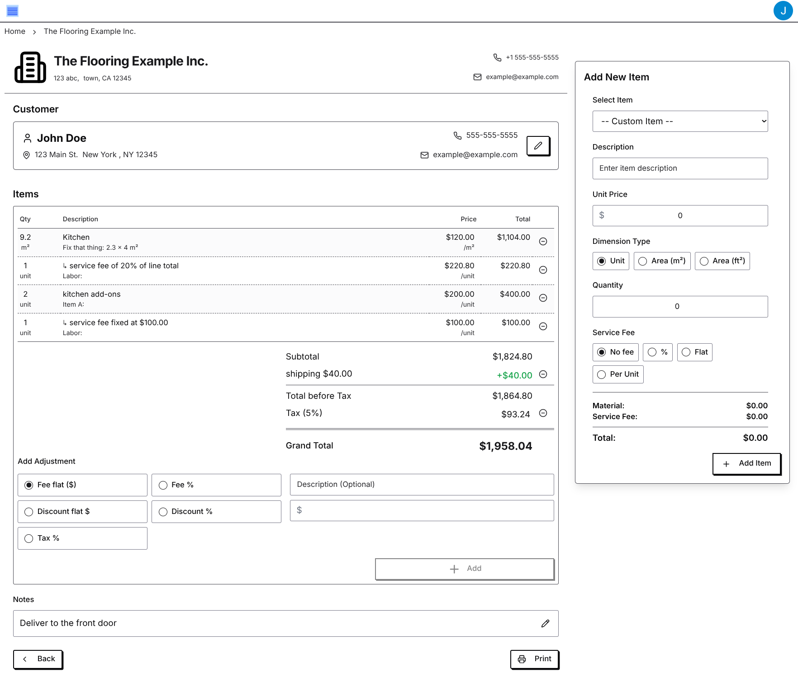
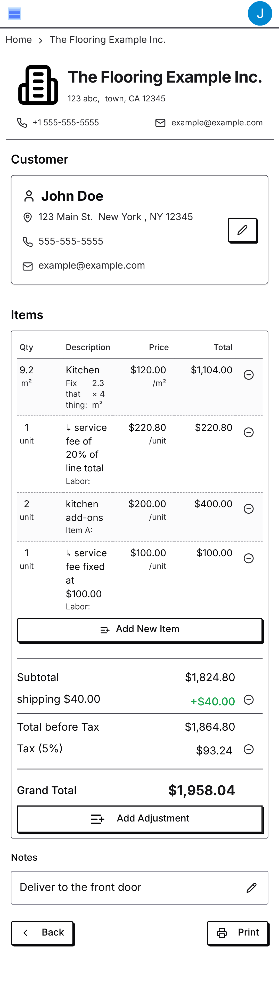

# Simple Business Journal

Simple Business Journal is a full-stack collaborative web application for creating and managing business estimates, transactional payment records, and parametric 3D fabrication templates (**StoneForge Studio**).

Built as a TypeScript monorepo using **Next.js (App Router)**, **React Three Fiber**, **Tailwind CSS + Shadcn UI**, **next-intl**, **Zod**, and **Firebase** (Authentication, Firestore, Cloud Functions v2, Cloud Storage, and Hosting).

## Screenshots & Example Output

**Desktop:**


**Phone:**


**Example PDF:** [Example Estimate PDF](example.pdf)

## Features

* **Business Journals & Estimates:** Create and manage detailed estimates with material and labor line items (area, linear, and unit pricing), fixed/percentage adjustments (additions and discounts), taxes, customer and supplier contact details, work status tracking (`draft`, `in_process`, `delivered`), entry duplication, and RFC-4180 CSV export.
* **Transactional Payments:** Record, edit, and void payments per estimate via a dedicated server-side Firestore transaction (`mutatePayments`), with automatic subtotal, tax, balance due, and overpayment/credit calculations.
* **3D StoneForge Studio & Technical Drawings:** Interactive 3D parametric slab and assembly designer powered by React Three Fiber and Drei:
  * Reusable parametric templates with custom variables and a safe arithmetic expression evaluator (`evaluator.ts`).
  * Nested slab hierarchies, cutouts, edge finishes, dimension labels, and customizable/preset orthographic & isometric camera views.
  * Template Gallery modal with fast-cache indexing and thumbnails stored in Cloud Storage.
  * Dedicated print layouts for **Technical Drawings** (`/journal/entry/technical-drawings`) and **Quick Print** (`/journal/quick-print`) with sequential snapshot capture.
* **Collaboration & Role-Based Access Control (RBAC):** Invite collaborators by email (`/share`) and assign granular roles enforced both in the UI and in Cloud Functions / Firestore security rules:
  * **Admin:** Full administrative control over the journal, settings, contributors, entries, and deletion.
  * **Editor:** Create, edit, duplicate, and delete entries (estimates and 3D templates).
  * **Staff:** Create and edit estimates and record payments.
  * **Viewer:** Read-only access to journal entries, estimates, and print views.
* **Internationalization (i18n):** Full English (`en`) and Portuguese (`pt`) support powered by `next-intl` (`frontend/messages/en.json` and `frontend/messages/pt.json`).
* **Shared Strict Schema Validation & Audit Trail:** All Firestore documents and callable payloads are validated with shared Zod schemas in `backend/functions/src/common/schemas/`, with optimistic concurrency guards and sanitized server-only audit logs.

## Monorepo Structure

```text
.
├── backend/
│   ├── firebase.json              # Firebase Functions, Firestore, Storage & Emulator config
│   ├── firestore.rules            # Firestore security rules (read-only client access; Admin SDK writes)
│   ├── firestore.indexes.json     # Composite Firestore indexes
│   ├── storage.rules              # Cloud Storage security rules for template thumbnails
│   ├── package.json               # Emulator & backend deploy scripts
│   └── functions/                 # Firebase Cloud Functions (Node.js 22 / TypeScript)
│       ├── src/
│       │   ├── common/schemas/    # Shared Zod schemas (Journal, Estimate, Studio, Config)
│       │   ├── helpers/           # Audit wrapper, email escaping, dot-notation utilities
│       │   └── bg-*.ts            # Callable & Firestore trigger Cloud Functions
│       └── tests/                 # Node test runner unit, security, RBAC & math test suites
├── frontend/                      # Next.js App Router frontend
│   ├── messages/                  # next-intl dictionaries (en.json, pt.json)
│   └── src/
│       ├── app/                   # Routes (journals, estimates, templates, quick-print, share)
│       ├── components/studio/     # 3D StoneForge Studio editor, viewer, inspectors & print pipeline
│       ├── components/ui/         # Shadcn UI components
│       ├── context/               # Journal & app contexts
│       ├── hooks/                 # Custom hooks (useStoneForgeData, useEstimate, use-toast)
│       └── lib/                   # DB handlers, auth, safe evaluator, financial math
└── deploy.sh                      # Full-stack deployment script (functions, rules, hosting)
```

## Firestore & Storage Data Model

All client mutations go through authenticated Firebase Cloud Functions using the Admin SDK. Clients have read-only access governed by `backend/firestore.rules` and `backend/storage.rules`.

* **`/journals/{journalId}`** (`JournalSchema`):
  * `title`, `journalType` (`"business"`), `isActive`, `createdAt`, `updatedAt`, `deletedAt`, `deletedBy`
  * `access`: map of `uid -> { email, role, displayName, photoURL }`
  * `access_array`: array of authorized user UIDs (used for security rule checks and queries)
  * `pendingAccess`: map of comma-escaped emails to invited roles
  * `details` (`businessDetailsSchema`): `{ currency, contactInfo, logo }`
* **`/journals/{journalId}/estimates/{entryId}`** (`estimateDetailsStateSchema`):
  * Estimate documents containing `name`, `isActive`, timestamps, and `details` (`confirmedItems`, `status`, `customer`, `supplier`, `logo`, `adjustments`, `taxPercentage`, `currency`, `notes`, `payments`).
* **`/journals/{journalId}/templates/{templateId}`** (`AssemblyTemplateSchema`):
  * 3D StoneForge Studio parametric assembly templates (`variables`, `components`, `cameraViews`, `description`, `thumbnailUrl`).
* **`/journals/{journalId}/fast-cache/templates`**:
  * Compact template gallery index (`{ [templateId]: { n, d, t } }`) automatically synchronized by the `onTemplateWritten` Firestore trigger.
* **`/journals/{journalId}/events/{eventId}`**:
  * Sanitized server-only audit trail written by `auditedCallable`; inaccessible to clients by default.
* **Cloud Storage (`/journals/{journalId}/templates/{templateId}/{fileName}`)**:
  * Template thumbnail images uploaded server-side via Admin SDK and readable only by active members of the owning journal.

## Prerequisites

* **Node.js 22** (required by `backend/functions` engine configuration)
* **Firebase CLI** (`npm install -g firebase-tools`)

## Local Development

1. **Install dependencies:**
   ```bash
   cd backend/functions && npm install
   cd ../../frontend && npm install
   ```

2. **Start the Firebase Emulator Suite (Auth, Functions, Firestore, Storage):**
   ```bash
   cd backend
   npm run dev
   ```

3. **Start the Next.js development server:**
   ```bash
   cd frontend
   npm run dev
   ```

## Verification & Testing

### Backend (`backend/functions`)
```bash
cd backend/functions
npm run lint    # ESLint checks
npm run build   # TypeScript compilation
npm test        # Build + full Node.js test suite (RBAC, security, schemas, math, studio)
```

### Frontend (`frontend`)
```bash
cd frontend
npm run lint       # ESLint (Next.js core-web-vitals + React Hooks rules)
npm run typecheck  # Strict TypeScript type checking (tsc --noEmit)
npm run build      # Production Next.js build
```

## Deployment

Use the root deployment script to deploy backend (Cloud Functions, Firestore rules/indexes, and Storage rules), frontend (Firebase Hosting), or both:

```bash
./deploy.sh              # Deploy backend (functions + rules/indexes/storage) and frontend
./deploy.sh --backend    # Deploy only backend (functions, firestore:rules, firestore:indexes, storage)
./deploy.sh --frontend   # Deploy only frontend hosting
```

See [backend/README.md](backend/README.md) for backend-specific commands and Cloud Function details.
